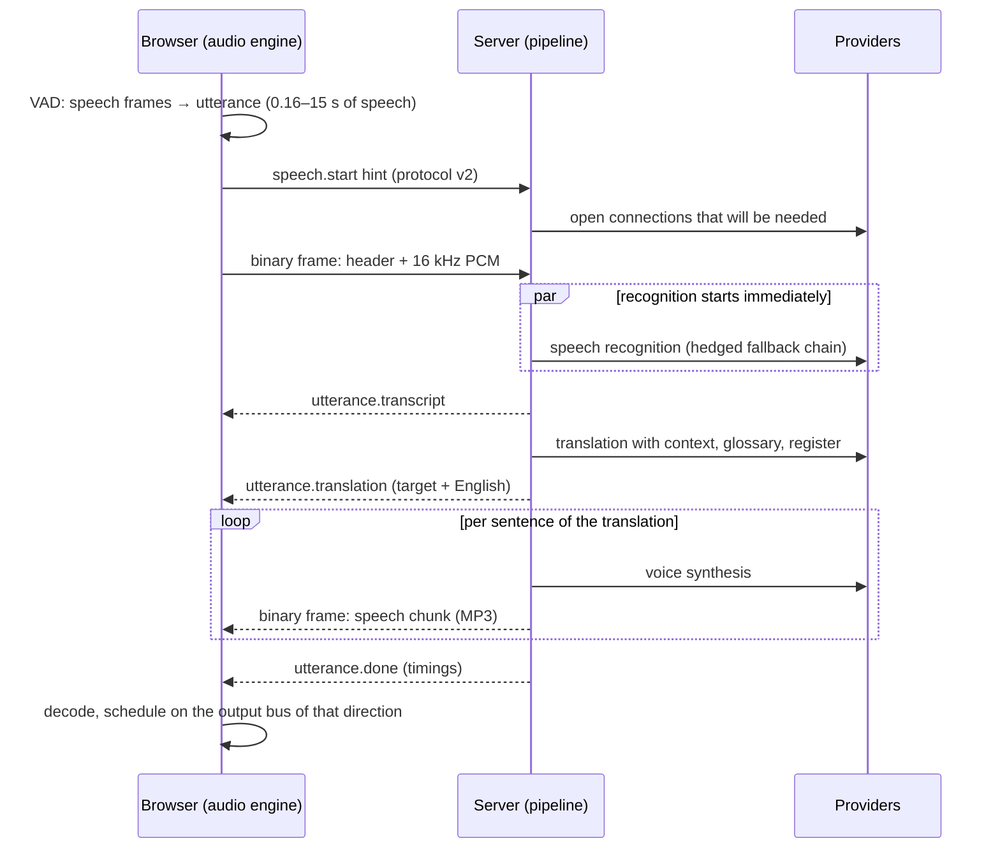

# Architecture

Tarjuman is a small Node.js server and a browser application, in one TypeScript project.

```
src/shared/   contracts used by both sides: wire protocol, settings, REST shapes, languages
src/server/   Fastify + WebSocket server: providers, fallback chains, per-call pipeline
src/web/      React application: audio capture, speech segmentation, mixing, interface
```

## The shape of the problem

A human interpreter in a call does four things: decides when a thought is complete,
understands it, says it in the other language, and stays out of the way while doing so.
The design follows the same four concerns.

1. **When is a sentence finished?** Decided in the browser, by voice activity detection.
2. **What was said, and what does it mean in the other language?** Decided on the server,
   by speech recognition and a translation model with conversation context.
3. **Say it.** A neural voice, played to the correct device.
4. **Stay out of the way.** Two fully independent directions, no feedback loops, and
   graceful behaviour when a free-tier provider says "not now".



## Why a cascade, and why sentence by sentence

There are two ways to build this: a _cascade_ (recognize → translate → speak) or an
end-to-end speech-to-speech model. The cascade is the dependable core here because every
stage can be swapped, measured and given a fallback independently, the translation step can
be steered (glossary, register, context), and English captions fall out for free. Its cost
is latency: a sentence is interpreted after it ends, typically one to three seconds later.

End-to-end streaming translation (Google's Live Translate model) removes that delay and is
the most promising next step; it is planned as a second engine behind the same interface
(see [ROADMAP.md](ROADMAP.md)), not as a replacement, because it accepts no glossary or
instructions and its free quota is not published.

## Browser

### Capture and segmentation (`src/web/src/audio`)

- `sources.ts` opens the three kinds of input: the microphone (noise suppression on, echo
  cancellation only without headphones), screen/tab sharing (all voice processing off,
  own-audio exclusion requested), and a plain input device such as a virtual cable (raw).
- `capture.ts` runs the Silero VAD model in the page (ONNX Runtime Web, via
  `@ricky0123/vad-web`, loaded on first use). The library is used only as a source of
  per-frame speech probabilities.
- `segmenter.ts` turns those probabilities into utterances. It is the part that decides how
  "live" the product feels, and it is pure logic with unit tests:
  - an utterance ends after `pauseMs` of silence (default 650 ms, user-adjustable);
  - after 9 s of continuous speech a breath (260 ms) is enough;
  - at 15 s the speech is cut at the quietest recent frame and continues in a new utterance,
    flagged as a fragment so the translator does not "complete" the sentence;
  - 320 ms of audio before the first speech frame is kept, so word onsets are not clipped;
  - 160 ms of detected speech is enough for an utterance, so a one-word answer ("Ja.",
    "جی") is not lost.

The speech detector runs in a 16 kHz audio context, so the conversion from the device's
sample rate is done by the browser. The detection library's own converter is not used: it
lets frequencies above 8 kHz fold back into the speech band, and that audio is what the
recognizer would hear.
When somebody starts to speak, the browser sends a `speech.start` hint (wire protocol
version 2) so that the server can open its connections to the providers before the
utterance is finished.

Only audio containing speech is sent. This is what makes free speech-recognition quotas
sufficient, and it keeps recognizers from inventing text for silence.

### Output (`output.ts`)

One `OutputBus` per destination, each an `AudioContext` routed with `setSinkId`:

| Bus      | Device             | Carries                                                                |
| -------- | ------------------ | ---------------------------------------------------------------------- |
| outgoing | virtual microphone | your translation, optionally your own voice underneath                 |
| incoming | headphones         | their translation, optionally their original voice underneath (ducked) |
| monitor  | headphones         | a quiet copy of your own translation, if you want to hear it           |

Speech chunks are decoded in arrival order and scheduled on the context's clock, so
playback is independent of timers. The voice service puts silence around every sentence
(about 0.2 s before, 0.8 to 1.4 s after); the browser trims it and inserts a short,
deliberate pause between sentences instead. The translated voice is routed to the chosen
device again after a microphone permission that was granted "this time" only. If the audio
device stops (a headset is unplugged), a banner says so and **Resume audio** restarts it;
browsers allow that only in response to a click. The reported queue length feeds
back to the server, which speaks faster when the interpreter falls behind.

### Feedback control (`app/controller.ts`)

A capture channel has a gate. While closed, its input is treated as silence.

- Without headphones the microphone gate closes while any translated speech is audible in
  the room, and reopens 600 ms after its last sample has left the device (the output
  latency of the device is counted in).
- When the whole system's audio is shared and the browser cannot exclude this page's own
  audio, the incoming gate closes while Tarjuman is speaking.
- In push-to-talk mode the microphone gate is closed unless the key (Space) is held. The
  key is read from the Tarjuman window, so it works after clicking a button, but only while
  that window has focus: Space held while Teams is in front goes to Teams.

Nothing on this path uses timers: browsers slow timers to once per second, or minute, when
a window is hidden, and Tarjuman is by design hidden behind Teams. The gate delay is
measured against the audio frames themselves.

### State (`state/`, `ui/`)

One store (zustand). The controller is its only writer; React components read it with
narrow selectors and call controller methods. `state/types.ts` is the contract between
the two halves.

The interface is dark by design (a Daylight variant is in the settings) and laid out the
same at every window size: a console with your side on the left and theirs, mirrored, on the
right (which way it interprets, lamp, start/stop key, the pipeline of the current sentence,
level meter), the conversation below it, and the typing box at the bottom. Ember is your
voice and frost is theirs. What is set once per call (devices, voice, Advanced) lives in a
side sheet behind each side's **Devices and voice** button. The conversation measures its
own width (a `ResizeObserver`, never a timer) and, when every language gets at least 300 px,
sets the languages side by side in fixed columns (theirs, captions, mine) with hairline
rules between them; otherwise it stacks them per sentence. While it is empty it shows
`Interlude`, a title page set on those same columns: it drafts the rules, writes the name
and lists the three steps to begin. Styles are plain CSS with design tokens in
`ui/styles/base.css`; `contrast.test.ts` checks the token colours against WCAG AA.

Followed during a call, the conversation rests on whole sentences. `ui/lib/reading.ts` is
the geometry (pure, with tests): the top edge falls between two sentences, room is left
under the newest one so that the page turns by whole sentences and one that fits in that
room simply appears, and a line still waiting for its words never takes the page from the
sentence being read. `Transcript` measures, leaves the room and glides there.

Motion only shows what the store already says and never sits on the capture path:

- `VoiceField` is the surface across the console: the damped wave equation on a small grid,
  drawn on a canvas as ridgelines. Each live level drives its own side, so the two voices
  meet in the middle, and the pointer disturbs it. At rest it runs at a third of the frame
  rate.
- `hooks/useEntrance.ts` plays the page's arrival once (GSAP) and then hands every property
  back to the stylesheet; the first sentences arrive on CSS delays.
- `ui/lib/motion.ts` registers GSAP and its SplitText plugin once; `RevealLines` uses it to
  let a new translation rise line by line, writing the text itself so React never reconciles
  the split. Translations that arrive together (a restore, the demo) appear without it.
- `hooks/useSmoothScroll.ts` gives the conversation Lenis wheel smoothing on GSAP's ticker.
- With reduced motion all of it is off and everything is drawn in its final state.

Type: Roboto Flex, set wide and light, for the interface's own words; Atkinson Hyperlegible
Next for captions and running text; Martian Mono for measurements only (times, delays,
counts); Noto Nastaliq Urdu (or Naskh) for Urdu. All are bundled; the build never inlines a
font, because the Content-Security-Policy only allows fonts from the server itself.

## Server

### Providers and the fallback chain (`src/server/providers`)

Three interfaces, `SttProvider`, `MtProvider`, `TtsProvider` (`types.ts`). Providers are
stateless and classify every failure as a `ProviderError` kind. `FallbackChain` (`chain.ts`)
owns everything that makes free tiers usable in a live conversation:

| Situation                                             | Reaction                                                                                                                                                             |
| ----------------------------------------------------- | -------------------------------------------------------------------------------------------------------------------------------------------------------------------- |
| No key                                                | provider is skipped                                                                                                                                                  |
| Rate limited                                          | cooldown for the time the provider asks for, next provider answers                                                                                                   |
| Per-minute budget used up                             | skipped before it can answer 429                                                                                                                                     |
| Timeout or server error                               | exponential cooldown, 5 s → 60 s                                                                                                                                     |
| Keeps answering slowly                                | rested (30 s, doubling up to 2 min) after two requests in a row that the fallback, started later, answered first                                                     |
| Key rejected                                          | disabled until keys change                                                                                                                                           |
| Repeated "bad request"                                | assumed misconfigured (retired model), rested for a minute                                                                                                           |
| Slow answer                                           | _hedging_: after about 2.5 s the next provider is started in parallel and the first valid answer wins; the recognizer that also translates (Gemini audio) gets 3.5 s |
| Everything resting, or the only usable provider fails | one resting provider is tried as a last resort                                                                                                                       |
| Voice service timed out                               | the voice step fails fast; the caption is already on screen                                                                                                          |

A rest that a provider asked for itself (a rate limit) is never shortened or lifted by an
unrelated request. Each provider also has a per-minute budget that Tarjuman keeps to by
itself; see [PROVIDERS.md](PROVIDERS.md).

Per-language preference is applied per request: for Urdu the multimodal model is tried
first, for German and English Whisper.

Because the APIs change faster than this code, the model-backed providers negotiate:
`GeminiNegotiator` walks to the next candidate model on "not found" and to a plainer
request shape on "bad request"; `OpenAiCompatMtProvider` steps from strict JSON schema to
JSON mode to plain. The first shape that works is remembered.

### One prompt (`mt/prompt.ts`)

All LLM providers use the same interpreter prompt and the same answer parser. The model
returns JSON with English first and the spoken language second; the parser rejects answers
in the wrong script, missing languages and rambling, which sends the request to the next
provider. Everything said in the meeting, the sentence being translated as well as the
earlier turns given as context, is passed as data inside delimiters that it cannot close,
and the prompt states that it is never an instruction. A model can still be talked into a
wrong translation; it cannot be talked out of the answer format.

### The pipeline (`pipeline/session.ts`)

One `InterpreterSession` per WebSocket.

```
utterance N    [ STT ]──▶[ translate ]──▶[ synthesize + send ]
utterance N+1     [ STT ]─────▶[ translate ]────▶[ synthesize + send ]
```

- Recognition starts the moment audio arrives, for all utterances in parallel.
- Translation runs in arrival order per channel (the _text lane_): each sentence is context
  for the next.
- Synthesis runs in order on a second lane, so translating sentence N+1 never waits for the
  audio of sentence N. The first sentence of a translation is synthesized and sent on its
  own; the rest follows while it plays. A translation that would be spoken more than 15 s
  late is not spoken; the caption stays and is marked as not spoken.
- The voice needs a connection to the voice service. Idle connections to the providers are
  kept for a minute (Node closes them after 4 s by default, which cost a TLS handshake of
  230 to 320 ms on nearly every request), and the `speech.start` hint opens the ones that
  will be needed. On the keyless voice a sentence took about 1.0 to 1.5 s with a new
  connection per request and about 0.4 s with the connection opened ahead.
- The two channels share nothing but the conversation memory (the last few turns, in RAM
  only), so one direction cannot hold up the other.
- Every failure becomes exactly one event for that utterance. A voice failure still
  delivers the caption. English captions are optional: a missing one does not discard the
  spoken translation.

Before anything is spoken, `hallucination.ts` checks the transcript: Whisper's own
no-speech rule, a confidence floor, repetition loops, known artefacts ("Untertitel der
Amara.org-Community"), wrong script for the channel, an echoed prompt, stock phrases on
weak audio, and more text than the audio could hold. Recognizer boilerplate is removed
sentence by sentence instead of dropping the whole utterance, text in parentheses that
people really said is kept, and a real one-word answer ("Ja.", "جی") is not dropped on
ordinary confidence. The patterns are deliberately narrow, because this tool is used to
talk about subtitles and translation.

### Transport and security (`http/`)

- JSON text frames for events; binary frames (`[length][JSON header][payload]`) for audio in
  both directions. Everything from the browser is validated before it reaches the pipeline.
  The wire protocol is at version 2 (`PROTOCOL_VERSION` in `src/shared/protocol.ts`); version
  2 added the `speech.start` hint.
- The server listens on 127.0.0.1 by default. A local server is reachable by every web page
  the user visits, so requests are checked for same origin and for a loopback `Host`
  (against cross-site requests and DNS rebinding).
- Any other listen address requires `ACCESS_TOKEN`; the server refuses to start without it.
- API keys live on the server (environment first, then `data/keys.json`) and are never sent
  to the browser; only masked hints are. The file is restricted to the current account when
  it is saved: mode 0600 on Linux and macOS, an access-control list (`icacls`) on Windows.
- The page is served with a strict Content-Security-Policy and loads nothing from third
  parties: fonts, the VAD model and the ONNX runtime are bundled.
- Transcripts and translations are not logged unless `LOG_TRANSCRIPTS=1`; request URLs are
  logged without their query string.
- The server uses its own HTTP client for the providers. It honours `HTTPS_PROXY`,
  `HTTP_PROXY` and `NO_PROXY`, including values set in `.env`, on every supported Node
  version. Only `NODE_EXTRA_CA_CERTS` (for a proxy that inspects TLS) has to be set in the
  real environment, because Node reads it at start-up.
- `.env`, the data folder and the built web app are found relative to the project folder,
  whatever the current directory is. A `.env` saved by Windows PowerShell 5.1 (UTF-16) is
  read correctly.
- Behind a reverse proxy the Host header no longer identifies the site, so `PUBLIC_ORIGIN`
  names the one origin requests may come from.

## Decisions and their reasons

| Decision                                       | Reason                                                                                                                                                                        |
| ---------------------------------------------- | ----------------------------------------------------------------------------------------------------------------------------------------------------------------------------- |
| Browser + virtual cable instead of a Teams bot | A bot that receives call audio must be a C#/.NET service on Windows in Azure with tenant-admin consent. The browser route needs no permissions from anyone and costs nothing. |
| Speech detection in the browser                | Saves quota and bandwidth, keeps silence away from recognizers, and makes endpointing tunable per user.                                                                       |
| Own segmenter on top of the VAD library        | The library has no maximum segment length and no adaptive pause, both essential for interpreting monologues.                                                                  |
| Multimodal model for Urdu recognition          | Published comparisons show Whisper at 20–50 % word error rate on Urdu (worse with English terms mixed in), an order of magnitude behind Gemini. One call also replaces two.   |
| LLM translation instead of classic MT          | The input is imperfect recognizer output. An LLM repairs it from context, keeps names and terms, and controls the form of address.                                            |
| Edge read-aloud voices by default              | The only keyless source of natural Urdu voices. Azure AI Speech (same voices, official) is the configured upgrade and is preferred automatically once a key is present.       |
| Hedged requests                                | A slow answer hurts a live conversation more than a failed one; a second request costs little.                                                                                |
| Single package, shared contracts               | One install, one build, and the protocol cannot drift between client and server.                                                                                              |
| No database                                    | Settings live in the browser, keys in one file, transcripts only on screen until exported. Nothing to leak, nothing to migrate.                                               |

## Testing

| Layer                                                    | How                                                                                                                                          |
| -------------------------------------------------------- | -------------------------------------------------------------------------------------------------------------------------------------------- |
| Pure logic (segmenter, chain, filters, prompt, protocol) | Vitest unit tests                                                                                                                            |
| Providers                                                | Vitest with an injected `fetch`; the Edge voice against a local WebSocket stand-in; tokens against vectors from the reference implementation |
| Server                                                   | Vitest against the real app on a real socket, with mock providers                                                                            |
| Everything together                                      | Playwright: real Chromium, recorded German speech as the microphone, mock providers                                                          |
| Real providers                                           | `npm run doctor`, with your keys                                                                                                             |
